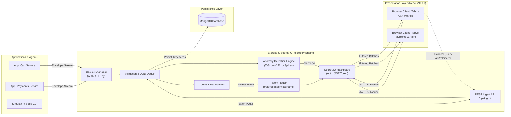
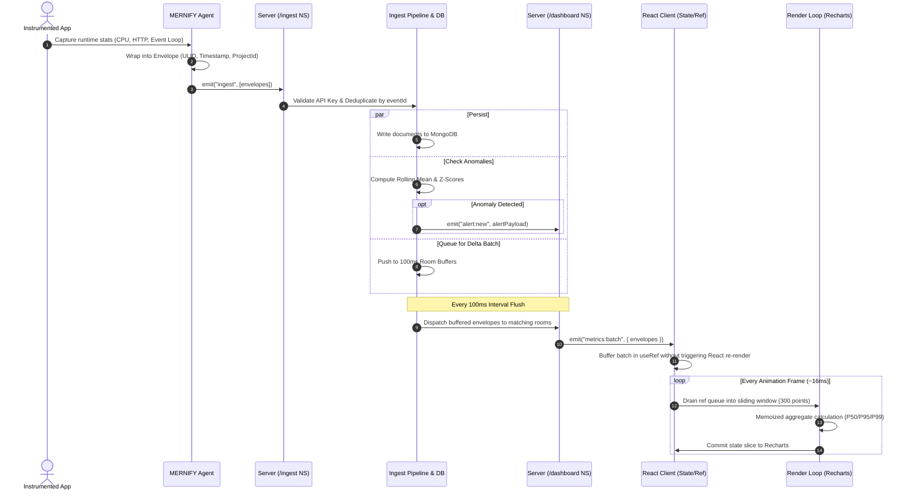

# MERNIFY Architecture Specification

## 1. System Overview

**MERNIFY** is an open-source, lightweight, real-time observability and telemetry platform designed on the MERN stack (MongoDB, Express, React, Node.js) with dual Socket.IO namespaces. The architecture delivers sub-second metric ingestion, automated statistical anomaly detection, historical time-series storage, and reactive, non-blocking browser visualisations capable of sustaining thousands of concurrent events per second.

---

## 2. System Architecture

The following diagram illustrates the topological boundary separation between the ingestion tier, storage engine, real-time fanout pipeline, and consumer dashboard applications.



---

## 3. End-to-End Data Flow

The sequence diagram below walks through the complete lifecycle of a telemetry data point from agent-side collection, through the dual-namespace broker, to RAF-buffered React canvas updates.



---

## 4. Telemetry Data Model

### Envelope Specification
Every event across the platform adheres to a standardized monotonic Envelope format:

```typescript
interface TelemetryEnvelope<T = any> {
  eventId: string;          // Globally unique monotonic ULID
  projectId: string;        // Tenant / Project identifier (e.g., "proj_demo")
  serviceName: string;      // Logical service name (e.g., "cart-service")
  instanceId: string;       // Unique worker/container ID (e.g., "cart-pod-a1b2")
  seq: number;              // Monotonic sequence number per instance
  ts: number;               // Milliseconds unix epoch timestamp
  type: "metrics" | "http" | "error" | "heartbeat" | "custom" | "log";
  payload: T;               // Strongly typed payload matching type
}
```

### Payload Types Reference

| Type | Field Name | Type | Description |
| :--- | :--- | :--- | :--- |
| **`metrics`** | `cpuPercent` | `number` | System/Process CPU utilization percentage (0.0 – 100.0) |
| | `memRssMB` | `number` | Resident Set Size memory consumed in Megabytes |
| | `heapUsedMB` | `number` | V8 engine active heap memory in Megabytes |
| | `eventLoopLagMs` | `number` | Event loop execution delay in milliseconds |
| | `uptimeSec` | `number` | Service process uptime duration in seconds |
| **`http`** | `windowMs` | `number` | Time aggregation window in milliseconds (e.g., 1000) |
| | `requests` | `number` | Total HTTP requests handled in this window |
| | `errors4xx` | `number` | Total client error responses (status 400-499) |
| | `errors5xx` | `number` | Total server error responses (status 500-599) |
| | `latencyP50` | `number` | 50th percentile response latency in milliseconds |
| | `latencyP95` | `number` | 95th percentile response latency in milliseconds |
| | `latencyP99` | `number` | 99th percentile response latency in milliseconds |
| | `byRoute` | `Record<string, RouteStats>` | Map of route keys (e.g. `"GET /cart"`) to `{ count, errors, p95 }` |
| **`error`** | `message` | `string` | Unhandled error message or rejection reason |
| | `stackHash` | `string` | MD5/SHA hash of normalized stack trace for auto-grouping |
| | `route` | `string` | Associated HTTP route or background worker context |
| | `count` | `number` | Number of occurrences grouped in this event |
| | `stack` | `string?` | Optional raw stack trace string |
| **`heartbeat`** | *(empty)* | `object` | Ping payload (`{}`) verifying process liveness |
| **`custom`** | `name` | `string` | Custom metric or business counter key |
| | `value` | `number` | Numeric value for the custom metric |
| **`log`** | `level` | `"debug" \| "info" \| "warn" \| "error"` | Log severity level |
| | `message` | `string` | Log line message payload |

---

## 5. Alert & Anomaly Model

The anomaly detection engine calculates moving statistics over incoming metric streams. When metric values deviate significantly from historical baselines, or critical thresholds are breached, an Alert entity is emitted:

```typescript
interface Alert {
  id: string;               // Unique alert identifier
  projectId: string;        // Project target
  serviceName: string;      // Affected service
  type: "zscore" | "error_rate" | "service_down";
  metric: string;           // Target metric (e.g., "cpuPercent", "http.errors5xx")
  severity: "warning" | "critical";
  message: string;          // Human-readable alert description
  value: number;            // Recorded triggering value
  threshold: number;        // Breached threshold or z-score cutoff
  ts: number;               // Trigger timestamp in milliseconds
  resolved: boolean;        // Resolution state
}
```

### Anomaly Rules
1. **Z-Score CPU & Memory Spike Detection**: Evaluates rolling mean ($\mu$) and standard deviation ($\sigma$). If $|z| > 2.5$ and value $> 85\%$, emits a `warning`. If value $> 95\%$, triggers a `critical` alert.
2. **HTTP Error Rate Cascade**: Triggers when $5\text{xx}$ error ratio exceeds $5\%$ of total request volume over a rolling 10-second window.
3. **Service Heartbeat Timeout**: If no heartbeat or telemetry envelope is received from an active service instance within 15 seconds, its status transitions to `down` and an automated `service_down` alert fires.

---

## 6. Socket.IO Namespaces & Subscription Routing

MERNIFY splits real-time traffic across two decoupled namespaces to prevent credential leakage and wire contention:

### 1. `/ingest` Namespace
- **Authentication**: `auth: { apiKey: string }` validated during the initial handshake.
- **Client Protocol**:
  - `ingest`: Payload contains `TelemetryEnvelope[]`. Server responds via acknowledgement callback: `{ accepted: number, duplicates: number, rejected: number }`.
  - In-flight deduplication: Discards any incoming event where `eventId` exists in the local sliding window cache.

### 2. `/dashboard` Namespace
- **Authentication**: `auth: { token: string }` containing a verified JWT.
- **Client Protocol**:
  - `subscribe`: `{ projectId: string, services?: string[] }`. Joins rooms matching `project:{projectId}:service:{serviceName}`.
  - `unsubscribe`: Leaves active service rooms.
- **Server Broadcasts**:
  - `metrics:batch`: Emitted every 100ms containing arrays of flushed envelopes.
  - `alert:new`: Broadcast immediately when an anomaly or health transition occurs.
  - `service:status`: Broadcast when a service transitions between `up` and `down`.

### Room Naming Convention
```
project:{projectId}:service:{serviceName}
```
Clients subscribe only to the services currently visible on their screen or active tab, keeping browser CPU overhead negligible.

---

## 7. Performance Optimizations

1. **RequestAnimationFrame (RAF) Buffering**:
   Incoming WebSocket delta batches arrive every 100ms. Rather than triggering standard React `useState` updates on every packet (which would cause severe UI stuttering), payloads are appended to a mutable `useRef` queue. A RAF loop flushes this queue at the browser's native refresh rate (60 FPS / 16.6ms), coalescing multiple socket events into a single repaint.
2. **Fixed 300-Point Sliding Window**:
   Live timeseries charts maintain a maximum of 300 data points per metric series. As new points enter the window, older points are pruned, ensuring constant $O(1)$ memory usage.
3. **Memoized Chart Visualizations**:
   Chart subcomponents and percentile calculations (`P50`, `P95`, `P99`) are wrapped with `React.memo` and `useMemo` with granular selector dependencies.
4. **100ms Server-Side Delta Batching**:
   Incoming envelopes are not dispatched one-by-one. The server buffers data points into per-room arrays and flushes them once every 100ms, minimizing network packet overhead.
5. **ULID Deduplication & `asOf` Cursor Reconciliation**:
   When toggling from historical queries (REST `GET /api/telemetry`) to live streaming, duplicate packets are filtered using `eventId` set lookups and the historical response's `asOf` timestamp cursor.
